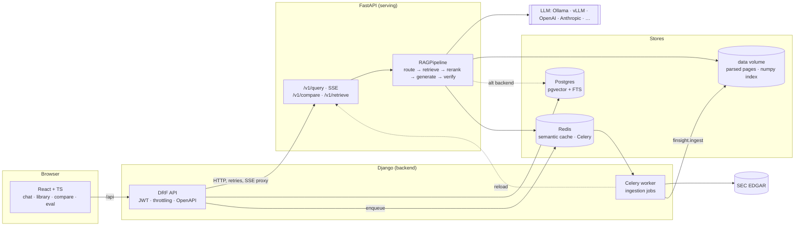

# Architecture

## Layers and the dependency rule

`frontend → backend API → services → (serving over HTTP | ml package)`

* **`ml/` (the `finsight` package) never imports Django or FastAPI.** The same code runs from the CLI, a notebook, a
  Celery task, the serving app and the tests. This is what makes it testable without a web stack.
* **Every swappable part sits behind a Protocol** in `ml/src/finsight/interfaces.py` (`DocumentParser`, `Chunker`,
  `Embedder`, `VectorStore`, `KeywordIndex`, `Reranker`, `LLMProvider`, `Cache`) and is chosen by name from YAML
  (`registry.py`). Changing the LLM, embedder or vector store is a one-line config change; see the README.
* **Views and tasks are thin.** Django views validate input and call `services.py` (writes) or `selectors.py`
  (reads); Celery tasks load an id and call a service.

## Query path

1. **Route** – find the company in the question (name match against the index, or an LLM returning JSON) → metadata
   filter; classify lookup / numeric / comparison.
2. **Transform (optional)** – multi-query, HyDE, or decomposition for comparisons.
3. **Retrieve** – dense top-50 (+ BM25 top-50 in hybrid mode) → Reciprocal Rank Fusion.
4. **Rerank (optional)** – cross-encoder `bge-reranker-v2-m3` → top 8.
5. **Generate** – a versioned Jinja prompt; the model must cite `[doc_id:page]` and put arithmetic in
   `<calc>…</calc>` tags that a safe AST evaluator computes (the model never does the math).
6. **Verify** – every citation must exist in the retrieved context; every number must appear in the context or
   come from the calculator; below a retrieval-score threshold the answer is "Not found in the provided documents."
7. **Cache** – a semantic cache (embedding cosine > 0.95 and identical filters) short-circuits repeated questions.

Pages are **0-indexed** in the data and in citations (this matches FinanceBench's evidence pages); the UI shows
page + 1.

## Ingestion

`EDGAR / PDF → parse (PyMuPDF · BeautifulSoup) → tables (Markdown + rows) → chunk (recursive | section-aware)
→ contextual header → embed → index`. Idempotent: chunk ids are content hashes, so re-ingesting changes nothing.
The parser is chosen from the file extension, so one index can mix FinanceBench PDFs and EDGAR HTML filings.

## Index versioning (pgvector backend)

Rows carry `index_version`; a one-row meta table names the active version. Re-index into version N+1 while N keeps
serving, then `activate(N+1)` flips readers in one transaction (it refuses an empty version). Old versions are dropped
explicitly, never the active one.

## Observability

* `serving` exposes Prometheus metrics (`/metrics`): request count, latency histogram, cache hits, tokens, refusals,
  guardrail failures. Grafana provisions an overview dashboard from `infra/grafana/dashboards/finsight.json`.
* Langfuse tracing is optional and a no-op without `LANGFUSE_*` keys.
* Django logs JSON lines.
